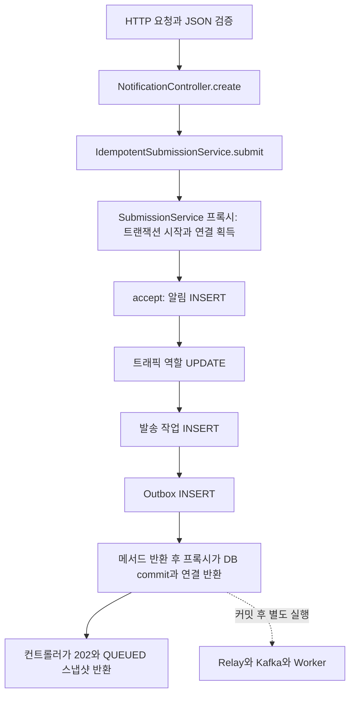

# S7 실시간 접수 한 건의 흐름과 구간 측정

2026-11-03 한국 시간. 시작1e2307c/main.
[10만 건 비교](S7_OFFSET_100K.md)에서 처리량은77.180→92.263/s로 높았지만 실시간 접수p95도97.694→202.728ms로 높게 관측됐다.
조건별1회이므로 원인은 미확정이다. 이번에는 기본 RECORD와 운영 코드를 유지하고 접수 요청 자체를 나눠 관찰한다.

## 먼저 코드로 따라가는 정상 접수

대상은 기본 비동기 프로필의 **Idempotency-Key 없는 POST /notifications**다.
`memory`/`sync` 비교 프로필과 키가 있는 중복 재요청 경로는 이번 요청별 측정 범위에서 제외한다.



| 코드 | 책임과 트랜잭션 |
| --- | --- |
| [NotificationController.create](../src/main/java/dev/jinhyeon/notificationlab/api/NotificationController.java) | 요청 검증 후 비동기 접수 서비스를 선택한다. 정상 신규 접수는202다. |
| [IdempotentSubmissionService.submit](../src/main/java/dev/jinhyeon/notificationlab/outbox/IdempotentSubmissionService.java) | NOT_SUPPORTED로 외부 트랜잭션을 잠시 중단한다. 중복 INSERT의 rollback 이후 승자의 새 상태를 읽기 위한 경계다. |
| [SubmissionService.accept](../src/main/java/dev/jinhyeon/notificationlab/outbox/SubmissionService.java) | 프록시가 REQUIRED 트랜잭션을 시작한다. 알림·역할·발송 작업·Outbox의SQL4회를 하나로 묶는다. |
| [JdbcNotificationStore.create](../src/main/java/dev/jinhyeon/notificationlab/notification/JdbcNotificationStore.java) | 기존 트랜잭션에 참여해 알림을 INSERT한다. 메서드마다 별도 커밋하는 것이 아니다. |
| [DeliveryTaskStore.create](../src/main/java/dev/jinhyeon/notificationlab/worker/DeliveryTaskStore.java) | 같은 접수 트랜잭션 안에서 발송 작업을 INSERT한다. |

정상 경로는 **연결1개·SQL4회·DB 커밋1회**다. `accept()`의 메서드 본문이 끝났다고 커밋까지 끝난 것은 아니다.
프록시가 commit/연결 반환을 마친 뒤 바깥 서비스와 컨트롤러로 정상 반환한다.
트랜잭션을 포함하려면 타이머를 프록시 바깥에 둬야 한다.

이 경로는 `NotificationService.send()`를 호출하지 않는다. 그 메서드는 동기 비교 프로필의 발송 경로다.
기본 API는 공급자 HTTP 호출이나 Kafka publish ACK를 기다리지 않는다.
202는 DB 접수 커밋을 뜻하며 공급자 수락/단말 도착을 뜻하지 않는다.
응답을 읽을 때 이미 Worker가 진행했을 수 있어도 응답 본문은 접수 시점의QUEUED 스냅샷이다.

## 무엇을 측정하는가

기존 DeliveryTiming은 Relay/Worker/consumer 구간만 관찰했으며 접수 트랜잭션은 범위 밖이었다.
이번 `apiAdmissionPilot`에서만 REALTIME 앱에 servlet 필터와 `SubmissionService` 프록시 바깥의 계측 advice를 붙인다.
기존 DataSource 래퍼로 API_SUBMIT의 JDBC 구간을 기록한다. 운영 Java/resources/격리 수준/풀 크기/발송 예산은 변경하지 않는다.

| 요청별 값 | 포함하는 범위 | 해석의 한계 |
| --- | --- | --- |
| clientMillis | 클라이언트 요청 준비 일부부터 응답 body 수신·상태 확인까지 | 테스트 JVM/HTTP 클라이언트/서버 진입 전 대기 등이 섞인다. ID JSON 파싱과 trace 완료 확인 대기는 제외한다. |
| serverMillis | 테스트 servlet 필터 진입→뒤 필터·MVC·본문 처리→필터 복귀 | Tomcat 진입 전 대기와 복귀 이후 네트워크 전송을 모두 포함하지 않는다. |
| STORE_CALL | accept 프록시 진입→트랜잭션 시작/본문/commit/연결 반환 | JDBC만이 아니라 프록시·매핑·계측 비용도 포함한다. |
| ACQUIRE | DataSource.getConnection 호출 | 풀 대기뿐 아니라 풀/드라이버 검사와 호출자 스케줄링도 섞일 수 있다. |
| EXECUTE | JDBC execute 계열4회 | DB CPU/잠금/네트워크/스케줄링을 단독으로 분해하지 않는다. |
| COMMIT | JDBC connection.commit 호출 | 서버 내부 fsync나 잠금 시간 그 자체와 같지 않다. |
| PREPARE/상태/RELEASE/STATEMENT_CLOSE | 준비·연결 상태 확인/복원·반환 등 | ResultSet 매핑/파라미터 바인딩 등 모든 호출을 포괄하지 않는다. |

`sqlExecutionMillis`는 코드 호출 순서의4개 값이다: 알림 INSERT, 역할 UPDATE, 작업 INSERT, Outbox INSERT.
SQL 본문을 수집하거나 파싱해 분류하지 않는다. 이번에 확인한 정상 신규 접수 코드/명령4회 가드와 함께 해석한다.

client/server/JDBC의 시간을 **같은 요청으로 대응**해 기록한다. 서로 다른 요청의p95끼리 빼서 비용을 계산하지 않는다.
clientMillis−serverMillis에는 서버 진입 전 대기/클라이언트/측정 경계 차이도 섞인다. 순수 네트워크 시간으로 부르지 않는다.
응답이 필터 복귀보다 먼저 클라이언트에 보이는 경계도 있어 그 차이가 항상 양수라고 가정하지 않는다.

`startAfterMillis−drainStartAfterMillis`를1000으로 나누면 캠페인 자원 표본의seconds와 대략 대응한다.
표본은약2초 간격이므로 근처의 waiting=0만으로 짧은 연결 대기나 잠금 대기가 없었다고 판단하지 않는다.

## 실험 상한과 안전성

- 정확히 한 개의 순차 HTTP probe만 진행한다. 서버 스레드의 ThreadLocal로 현재 요청만 연결하고 finally에서 제거한다.
- API trace는최대5000행, JDBC 구간은고정14개, 개별 SQL 시간은4개다. 본문/수신자/토큰/ID/SQL/예외 메시지를 저장하지 않는다.
- 원래 클라이언트 응답 제한5초를 유지한다. 응답 시간을 기록한 뒤 필터 완료를최대2초 확인하며 이 확인 대기는 clientMillis에 더하지 않는다.
- 각 요청의SQL4회/획득·커밋·반환1회/rollback0과202, 최종 trace 수=접수 수를 검증한다. 놓친 측정값을0으로 조용히 대체하지 않는다.
- 새 task는1000..10000건만 허용한다.10만/100만 건이나 기본 build에 자동 연결하지 않는다.
- 캠페인Relay2/완료 저장10, 실시간Relay1/완료 저장1/RECORD, 역할별Worker3/Hikari4/HTTP3/Redis3/queue0을 유지한다.
- 캠페인200/s·burst20, 총1000/s·burst100, Mock SUCCESS1ms, 기존 CPU/메모리와JVM512MiB 상한을 유지한다.
- ACK 후 PUBLISHED/DB 완료 후 offset과 모든 HTTP·DB·대상 매핑·파티션 offset 대조는 기존 실험과 동일하다.

```bash
caffeinate -i ./gradlew --no-daemon --console=plain apiAdmissionPilot -PdeliveryTargets=1000 -PoffsetMode=COUNT_TIME
caffeinate -i ./gradlew --no-daemon --console=plain apiAdmissionPilot -PoffsetMode=RECORD
# 앞 원본을 보존한 뒤 별도 실행
caffeinate -i ./gradlew --no-daemon --console=plain apiAdmissionPilot -PoffsetMode=COUNT_TIME
```

출력은 `build/reports/api-admission-pilot/MODE-targets-T.json`이며 요청별 결과는apiRequestTiming.rows에 있다.
새 계측 자체의 오버헤드가 있으므로 이전 무계측 실행과의 절대 시간 차이를 성능 개선으로 해석하지 않는다.
공통 probe의 clientMillis 마감도 응답 ID JSON 파싱 이전으로 명시했다. 기존 원본은 ID 파싱까지 포함했으며 이 미세한 경계 차이도 고려한다.
작은 데이터에서10만 건의 긴 지연이 재현되지 않을 수도 있다. 원인을 확인하지 못하면 정책이나 인덱스를 추측으로 바꾸지 않는다.

## 실제 작은 경로 검증

원본 내부 시각은UTC, 파일명의11-03은 한국 작업일이다.
[고정 소스9개 SHA-256](experiments/s7-api-admission-2026-11-03-source.json)을 사용했고 운영 Java/resources diff는0이다.
최초 컴파일은 servlet 필터 제네릭 타입 추론 오류로6초에 실패했다. 등록 타입을 명시한 뒤 선택 단위18개가5초/실패·오류·스킵0으로 통과했다.
이후 개별SQL 시간과 표본 대응 시각을 보강한 최종 소스는 아래1천/1만 건과 전체 회귀에서 검증한다.

### 1천 건 연결 검증

COUNT_TIME1000건은 **BUILD SUCCESSFUL57초/종료 코드0/테스트1개 통과/실패·오류·스킵0**이었다.
캠페인1000+실시간94=HTTP1094건을 전수 대조했고, 실시간94건의 요청별 SQL4회/획득·commit·반환1회/rollback0을 확인했다.
발송10.419초/95.974/s, 혼합44개 접수p95 18.468ms였다. 작은 표본을10만 건의 재현으로 표현하지 않는다.
[원본](experiments/s7-api-admission-2026-11-03-smoke.json)을 수정 없이 보존했다.

### 같은 소스의1만 건 비교

새 JVM/격리 인프라에서 RECORD→COUNT_TIME 각1회 실행했다.
두 task 모두 BUILD SUCCESSFUL/종료 코드0/각1개 통과/실패·오류·스킵0이었다. 전체2분36초/2분39초였다.

| 모드 | 발송초 / 처리량 | 혼합 API 표본 | 클라이언트 p95 / 최대ms | 서버 필터 p95 / 최대ms |
| --- | ---: | ---: | ---: | ---: |
| RECORD | 104.202 / 95.968/s | 466 | 21.373 / 183.529 | 18.939 / 164.991 |
| COUNT_TIME | 106.102 / 94.249/s | 468 | 26.318 / 239.539 | 22.439 / 230.339 |

캠페인20000+실시간1034=**HTTP21034건**의 전체 대상/시도 이력1회/Outbox PUBLISHED/HTTP 감사/각partition offset=end/quota를 대조했다.
중복·대상 매핑·Mock 제한/오류0이었다. 실시간1034개는단독100+혼합934개이며 모두 요청별 구간이 대응됐다.
별도1천 건까지 합하면HTTP22128건이다. 단일 연속21000건 발송 실험으로 해석하지 않는다.

캠페인 offset commitSync는10000→2612회(73.88% 감소), 누적63.518→19.055초였다.
그런데 이번1만 건에서는 처리량 개선을 관측하지 못했다. 조건별1회/공유 호스트/새 계측의 오버헤드/무작위 파티션 분포를 고려한다.
기존10만 건의97.694→202.728ms 수준의p95는 재현하지 못했다. COUNT_TIME의 지연 악화 원인이 해결되거나 확정된 결과가 아니다.
운영 기본 RECORD와 완료 저장1을 유지한다.

### 같은 느린 요청 안에서 비용을 보기

혼합 클라이언트 응답이 느린 순서의상위ceil(N×5%)건을 선택했다. 두 조건 모두24건이다.
각 열은 **그24개의 같은 요청에서 계산한 평균**이다. 별도 percentile끼리 빼지 않는다.

| 모드 | client / server 평균ms | 접수 프록시 평균ms | 연결 획득 평균ms | SQL4회 합 평균ms | commit 평균ms |
| --- | ---: | ---: | ---: | ---: | ---: |
| RECORD | 39.226 / 36.259 | 33.513 | 2.578 | 14.422 | 10.266 |
| COUNT_TIME | 48.382 / 43.633 | 41.431 | 0.254 | 16.330 | 18.775 |

이 작은 표본의 느린 요청군에서는 SQL/commit 호출의 누적 시간이 크게 관측됐다.
획득만이 모든 긴 응답을 설명하지 않으며 JDBC 실행/commit 시간도 DB 서버의 특정 원인과 같지 않다.

| 실제 요청 사례 | client / server ms | 획득ms | SQL 합ms | commit ms |
| --- | ---: | ---: | ---: | ---: |
| RECORD 최댓값 | 183.529 / 164.991 | 0.010 | 81.119 | 46.070 |
| RECORD 두 번째 | 122.292 / 119.916 | 59.933 | 38.508 | 16.829 |
| COUNT_TIME 최댓값 | 239.539 / 230.339 | 0.003 | 57.984 | 139.999 |

마지막 사례의 실제SQL 순서별 값과 다른 느린 요청의 대응 구간은
[원본에서 계산한 요약·명령·시각·해시](experiments/s7-api-admission-2026-11-03-analysis.json)에 보존했다.
한 요청의 특정SQL이 길었다고 인덱스 미사용이나 잠금을 확정하지 않는다.
두1만 건의97개 자원 표본에서 실시간 Hikari waiting은모두0이었지만, 요청별 획득 호출59.933ms도 관측됐다.
이를59.933ms 전부 풀 대기라고 부르거나 표본0만으로 연결 대기가 없었다고 결론 내리지 않는다.

### 현재 판단과 다음 검증

접수 연결/SQL/commit/서버 처리/클라이언트 시간을 같은 요청으로 분리해서 관찰할 근거를 확보했다.
**10만 건의p95 악화와 최초100만 건의5초 timeout 원인은 아직 미확정**이다.
다음 작은 단계는 긴 SQL/commit 호출에서 DB 내부 잠금·I/O와 호출자 스케줄링을 구분할 수 있는 증거를 제한적으로 수집하는 것이다.
현재 증거만으로 풀/인덱스/격리 수준을 바꾸지 않는다.10만/100만 건 재실행이나 실제 공급자 호출은 이번에 하지 않았다.

## 기본 회귀에서 확인한 검사식 수정

개별SQL 시간을 추가한 뒤 첫 전체 회귀에서 새 테스트의 금지 문자열검사 `sql`이 정상 숫자 필드 `sqlExecutionMillis`까지 거절했다.
이 실행은156개 통과/1개 실패를 확인한 시점에 중단했으며 종료 코드130이다.
[중단 원본 요약](experiments/s7-api-admission-2026-11-03-interrupted-regression.json)을 통과로 기록하지 않는다.
검사를 실제 SQL 원문 필드의 JSON 키로 좁힌 뒤 해당 테스트5개는4초/실패·오류·스킵0으로 통과했다.

[실험 당시 소스](experiments/s7-api-admission-2026-11-03-source.json)와
[최종 회귀 소스](experiments/s7-api-admission-2026-11-03-source-final.json)의 차이는 이 테스트 검사식 한 줄뿐이다.
실험에서 실행하는 계측 코드와 운영 코드는 같으며 실제 발송 실험을 검사식 수정 후 재실행했다고 주장하지 않는다.

## 스스로 설명해 볼 질문

1. SQL4회인데 DB 커밋은 왜1회인가? 여러 @Transactional 메서드가 호출되면 항상 여러 연결을 쓰는가?
2. accept 메서드 본문만 측정하면 어떤 시간이 빠지는가?
3. API가202를 반환했는데 Kafka나 공급자 발송이 아직 완료되지 않아도 되는 이유는 무엇인가?
4. Pool waiting 표본이0인데 SQL이나 commit 호출이 느릴 수 있는가? 현재 측정으로 어디까지 증명할 수 있는가?
5. 처리량이 높아져도 실시간 요청의p95가 나빠지면 적용 여부를 어떤 기준으로 판단할 것인가?

## 참고

- [Spring Framework6.2.19 트랜잭션 프록시](https://docs.spring.io/spring-framework/reference/6.2/data-access/transaction/declarative/annotations.html)
- [Spring Framework6.2.19 JDBC 연결과 트랜잭션](https://docs.spring.io/spring-framework/reference/6.2/data-access/jdbc/connections.html)
- [OncePerRequestFilter6.2.19](https://docs.spring.io/spring-framework/docs/6.2.19/javadoc-api/org/springframework/web/filter/OncePerRequestFilter.html)


## 최종 기본 회귀와 보존

최종 `caffeinate -i ./gradlew --no-daemon --console=plain build`는 **BUILD SUCCESSFUL16분58초/종료 코드0**이었다.
새38개 클래스 JUnit XML과 콘솔에서 **308개 통과/실패·오류·스킵0**을 대조했다.
기존302개+요청 대응/격리/상한5개+API JDBC 트랜잭션1개다. 기본 회귀는 실제 재실행했고 두 실행 JAR task는UP-TO-DATE였다.
최종 소스 해시와 운영 Java/resources diff0을 확인했다. 중단된 첫 실행과 최종 전체 통과를 구분한다.

새 원본/계산 요약의 UUID·비유한 값·민감 필드 미포함과 문서 링크를 확인했다.
원래100만 건 FAIL 원본 해시는 유지했다. 사용자DB/.env/IntelliJ/volume, 기본 발송 정책을 변경하지 않았다.
실제 공급자/유료 자원/10만·100만 건 재실행/푸시는 하지 않았다.
최종 Docker에는 기존 notification-lab-mysql-1만healthy로 남았고 격리 검증 컨테이너는 정리됐다.
