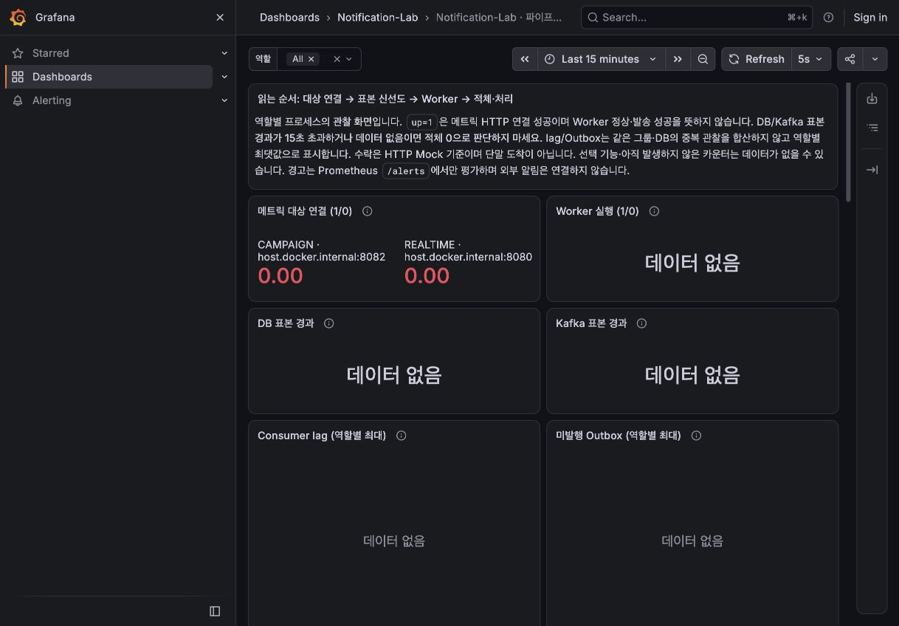

# S8: Prometheus와 Grafana로 파이프라인 관찰

## 이번에 추가한 것

앱의 `/actuator/prometheus` 노출에 실제 수집 서버와 대시보드를 연결했다.
기존 앱/DB/Worker 처리 정책을 바꾸지 않고, 별도 선택 Compose와 기본 회귀의 통합 테스트를 추가했다.
Prometheus **3.13.5 LTS**, Grafana OSS **13.3.0**을 고정했다. 공식 배포 정보를 확인하고 실제 이미지를 내려받아 실행했다.

- [선택 Compose](../compose.monitoring.yml): 앱용 `compose.yml`과 별도 프로젝트·볼륨이다.
- [수집 설정](../monitoring/prometheus/prometheus.yml): 5초 scrape, 3초 timeout, 역할별 두 대상이다.
- [대시보드 JSON](../monitoring/grafana/dashboards/notification-lab.json): 22개 패널, 역할 필터, 고정 datasource UID다.
- [경고 규칙](../monitoring/prometheus/rules.yml)과 [제어 사례](../monitoring/prometheus/rules-test.yml): 누락·NaN·오래된 표본을 0으로 숨기지 않는다.
- [통합 테스트](../src/test/java/dev/jinhyeon/notificationlab/monitoring/MonitoringIntegrationTest.java): 실제 두 앱·MySQL·Kafka·Redis·HTTP Mock·Prometheus·Grafana를 연결한다.

수집 서버는 숫자를 저장하고 PromQL을 평가한다. Grafana는 그 서버에 쿼리해 화면을 그린다.
Grafana가 DB나 Kafka를 직접 조회하지 않는다. 앱의 `PipelineMetrics`가 약 5초마다 DB/Kafka를 관찰하므로
화면 새로고침을 빠르게 해도 업무 상태가 같은 속도로 갱신되는 것은 아니다.

## 로컬 실행

Docker Desktop에서 호스트 앱이 다음 주소로 실행 중인 구성을 대상으로 한다.

| 역할 | 앱의 메트릭 주소 | Prometheus에서 붙이는 lane |
| --- | --- | --- |
| 실시간 | `http://127.0.0.1:8080/actuator/prometheus` | REALTIME |
| 캠페인 | `http://127.0.0.1:8082/actuator/prometheus` | CAMPAIGN |

역할별 앱·공유 예산 초기화는 [S6 역할 분리 실행 절차](S6_TRAFFIC_ISOLATION.md)를 따른다.
모니터링 명령 자체는 앱이나 캠페인 작업을 시작하지 않는다. `.env`나 기존 DB 볼륨을 바꾸지 않는다.

```bash
docker compose -f compose.monitoring.yml up -d
# Prometheus 수집/규칙 YAML을 수정했다면 정상 구성을 검증한 뒤 다시 읽힌다.
docker compose -f compose.monitoring.yml kill -s SIGHUP prometheus
# 모니터링만 정지한다. 기존 앱/DB와 수집 볼륨은 유지한다.
docker compose -f compose.monitoring.yml stop
```

- [Grafana 대시보드](http://127.0.0.1:13000/d/notification-lab-s8)
- [Prometheus 대상 연결](http://127.0.0.1:19090/targets)
- [Prometheus 경고 평가](http://127.0.0.1:19090/alerts)

기본 포트는 13000/19090이며 `GRAFANA_PORT`/`PROMETHEUS_PORT`로 바꿀 수 있다.
Docker Desktop의 `host.docker.internal`로 호스트의 loopback 앱에 접근하는 경로를 이 Mac에서 확인했다.
Linux Engine에서 이 주소가 없거나 loopback 연결이 안 되는 경우의 실행은 검증하지 않았다.
앱을 무조건 `0.0.0.0`으로 열지 말고 환경에 맞는 수집 경로를 별도로 구성해야 한다.
CI 테스트는 Testcontainers의 호스트 포트 전달을 사용하며 localhost 포트를 무작정 공개하지 않는다.

Grafana는 **localhost 전용 익명 Viewer**다. 관리자 계정 자동 생성·로그인 폼·가입·기본 인증을 끄고
버전 관리한 JSON/provisioning 파일로만 내용을 바꾼다. UI에서 저장한 변경을 원본으로 취급하지 않는다.
공개 배포용 인증 설정은 아니다. Prometheus와 Grafana 포트는 둘 다 `127.0.0.1`에 바인딩한다.

Prometheus 메모리 384MiB/Go 한도320MiB, Grafana 512MiB를 제한했다.
TSDB는 24시간/256MB 보관 설정, 쿼리는 10초/동시4개/최대100만 표본,
scrape는 응답2MB/표본10000개/label20개로 제한했다.
TSDB 보관 크기는 WAL·진행 중 head까지 포함한 전체 디스크의 하드 쿼터가 아니다.
메모리 한도도 모든 호스트 자원/디스크 사용량의 상한을 의미하지 않는다.
DB/Redis/Kafka 노드 자체의 CPU·디스크를 수집하는 exporter는 이번에 추가하지 않았다.
두 named volume은 수집 데이터/대시보드 상태를 유지한다.

## 화면 읽는 순서

1. **대상 연결**: `up=1`은 메트릭 HTTP 수집 성공이다. Worker가 정지했거나 DB/Kafka가 실패해도 1일 수 있다.
2. **표본 신선도**: DB/Kafka 마지막 성공 수집 이후 경과다. 없음/NaN/15초 초과는 신뢰할 수 없는 표본이다.
   15초와 경고 지속30초는 로컬 관찰 기준이며 운영 SLO가 아니다. 데이터 없음은 중립색으로 표시한다.
3. **Worker 실행과 적체**: running=1도 pause 중일 수 있다. lag/활성 수/재개 예약과 같이 본다.
4. **처리와 자원**: 공급자 시도율·상태별 최종 결과율·처리 p95·단계별 평균·CPU/heap/DB pool을 비교한다.

| 패널/수식 | 의미와 주의점 |
| --- | --- |
| `max by(lane)(notification_consumer_lag)` | 요청+Retry의 committed 기준 lag. DLQ 제외. 같은 그룹을 여러 앱이 관찰한 값은 더하지 않는다. |
| `max by(lane)(outbox_unpublished)` | 같은 DB/역할의 미발행 수. FAILED도 포함한다. |
| `outbox_oldest_age_seconds` | 가장 오래된 미발행의 생성 시각 기준. 정상적인 미래 예약 Retry도 오래된 값일 수 있다. |
| `sum by(lane)(rate(..._total[window]))` | 재시작 reset을 처리한 뒤 프로세스별 증가율을 합친다. DB 전수 대조나 단말 도착 수가 아니다. |
| `sum(rate(timer_sum))/sum(rate(timer_count))` | 관찰 창의 가중 평균이다. 포함 관계인 handler와 하위 구간 시간을 더하지 않는다. |
| `histogram_quantile(0.95, sum by(lane,status,le)(rate(..._bucket[window])))` | 상태별 처리 Timer의 bucket 추정 p95다. 큐 대기·생성→완료·단말 지연 p95와 다르다. |
| POST `/notifications`의 sum/count | 서버 접수 처리 평균이며 p95나 클라이언트 지연이 아니다. |
| circuit state | 0=CLOSED, 1=OPEN, 2=HALF_OPEN. 활성화 여부는 실제 앱 설정으로 확인한다. |

`max` 방식은 **역할당 같은 DB 범위·같은 Consumer 그룹**을 관찰할 때의 중복 합산을 피한다.
서로 독립적인 그룹을 같은 lane에 붙일 경우 그룹 구분을 추가해야 한다.
프로세스마다 표본 시각이 다르므로 역할별 최대값이 원자적인 실시간 전체 상태는 아니다.
일부 인스턴스가 NaN이어도 다른 인스턴스의 값이 남을 수 있어, 표본 신선도는 인스턴스별로 함께 본다.

빈 시계열을 `or vector(0)`으로 채우지 않는다. 아직 발생하지 않은 지연 등록 카운터나
비활성 선택 기능은 데이터가 없을 수 있다. 기본 memory/sync 비교 프로필에는 DB/Kafka/Worker 메트릭이 없다.
이 규칙은 현재 비동기 앱을 대상으로 한다. 의도적으로 Worker를 끈 API 전용 프로세스는 이후 구성에서 별도로 분류해야 한다.
한 앱만 실행하면 다른 역할은 `up=0`으로 보인다. 이때 업무 적체를 0으로 판단하지 않는다.
lane은 수집 설정의 정적 라벨이므로 대상 포트와 실제 앱 역할을 맞춰야 한다.

## 실제 검증 시나리오

새 통합 테스트는 별도 임시 인프라에서 합성 알림 8건만 사용한다.
Compose의 실제 이미지·환경변수·명령·메모리 설정과 원본 provisioning/dashboard를 읽는다.
수집 대상 주소만 임시 포트로 치환한다. 사용자의 로컬 DB/토픽/예산과 분리된다.

1. 두 역할의 초기 알림을 하나씩 처리해 카운터의 첫 표본을 확보한다.
2. 캠페인 Worker를 pause하고 캠페인3개/실시간3개를 추가한다.
   Outbox 8개 PUBLISHED와 실시간4개 수락을 확인한다. 캠페인은 running=1, lag=3이며 실시간 lag=0이다.
3. 캠페인을 resume한다. DB 수락8개/수락 시도 이력8개/HTTP Mock 수락8개,
   역할별 완료 카운터4개/lag0을 확인한다. 공급자 시도율과 처리 p95도 유한한 양수로 조회된다.
4. Grafana에 등록된 22개 패널의 쿼리·설명·배치·옵션을 원본과 대조한다.
   모든 패널의 PromQL을 실행하고, Grafana datasource proxy가 Prometheus의 실제 두 대상을 읽는지도 확인한다.
   선택 기능의 빈 결과는 허용하지만 쿼리 오류는 통과시키지 않는다.
5. 캠페인 앱을 닫는다. 실시간 up=1/캠페인 up=0이며 캠페인 lag는 **빈 시계열**이다.
   과거 lag0을 현재 정상 값으로 사용하지 않는지 확인한다.

추가 promtool 8개 제어 사례는 정상0/표본 누락/오래된 표본/NaN/대상 종료/Worker 정지/동일 그룹 lag 중복 관찰/최근 성공 이후 현재 값 NaN이다.
경고는 표본 경과뿐 아니라 현재 DB 적체/lag의 유효성도 검사한다. 최근 성공 시각이 남아 있어도 현재 값이 NaN이면 정상으로 취급하지 않는다.
Alertmanager나 메일/메신저 전송은 연결하지 않았다. Prometheus 자체가 꺼진 상황의 외부 감시도 별도다.

```bash
./gradlew --no-daemon --console=plain test \
  --tests 'dev.jinhyeon.notificationlab.monitoring.MonitoringIntegrationTest'
./gradlew --no-daemon --console=plain build
# Java 실행 없이 규칙만 확인한다.
docker run --rm -v "$PWD/monitoring/prometheus:/etc/prometheus:ro" \
  --workdir /etc/prometheus --entrypoint /bin/promtool \
  prom/prometheus:v3.13.5 test rules rules-test.yml
```

기본 test의 입력에 monitoring 파일과 Compose를 등록했다. Java를 바꾸지 않고 JSON/YAML만 수정해도 회귀가 다시 실행된다.
실제 명령에는 macOS 절전 방지용 `caffeinate -i`를 사용했다.
초기 컴파일의 같은 이름 import 충돌과 Mock 초기화 helper 누락 실패를 보존하고 보완했다.
운영 앱의 오류가 아닌 새 테스트 구성의 문제였으며, 실패 실행을 통과로 덮어쓰지 않는다.
[초기 실패·당시 소스/로그 SHA](experiments/s8-monitoring-2026-11-06-failures.json),
[최종 집중 검증·고정 소스168개/구성/원본 SHA](experiments/s8-monitoring-2026-11-06-focused.json),
[관측 원본](experiments/s8-monitoring-2026-11-06-observation.json)을 보존했다.
최종 집중은 **48초/종료코드0/통합1개 통과·실패/오류/스킵0**이며 내부에서 규칙8개와 패널 쿼리27개를 확인했다.
같은 소스·설정의 전체 build는 **17분30초/종료코드0**, **49개 클래스·389개 통과/실패·오류·스킵0**이었다.
기존388개에 모니터링 통합1개가 추가됐다. promtool8개는 그 통합 테스트 내부 검증이며 JUnit 수와 합산하지 않는다.
WorkerConcurrencyTest15개도 다시 통과했다. 소스168개와 구성10개의 SHA가 집중 시점과 같은지 대조했다.
알림/HTTP Mock0.3.0 JAR task는 UP-TO-DATE이며 기존0.2.0 산출물과 구분했다.
[최종 로컬 검증·JUnit/전체 관측/설정·소스/JAR SHA](experiments/s8-monitoring-2026-11-06-validation.json)를 남겼다.
원격 CI나 푸시를 실행한 결과는 아니다. 다음은 S8 개별 실험의 반복 조건·원본과 기본값 선택 근거의 종합 대조다.

화면은 앱이 없는 로컬 구성에서도 직접 확인했다. 대상0/업무 지표 데이터 없음과 중립색 표시를 확인한 화면이며
실제 통합 시나리오 수치는 테스트의 별도 원본을 따른다. 대량 부하·성능 개선·다중 호스트 HA·단말 도착 검증은 아니다.



## 공식 참고

- [Prometheus 배포](https://prometheus.io/download/), [수집 설정](https://prometheus.io/docs/prometheus/latest/configuration/configuration/), [보관 범위](https://prometheus.io/docs/prometheus/latest/storage/)
- [Prometheus rule 단위 검증](https://prometheus.io/docs/prometheus/latest/configuration/unit_testing_rules/), [PromQL 함수](https://prometheus.io/docs/prometheus/latest/querying/functions/)
- [Grafana OSS 배포](https://grafana.com/grafana/download?edition=oss&platform=docker), [파일 provisioning](https://grafana.com/docs/grafana/latest/administration/provisioning/), [익명 Viewer](https://grafana.com/docs/grafana/latest/setup-grafana/configure-access/configure-authentication/anonymous-auth/)
- [Docker Desktop 네트워크](https://docs.docker.com/desktop/features/networking/), [Testcontainers 호스트 포트 전달](https://java.testcontainers.org/features/networking/)
