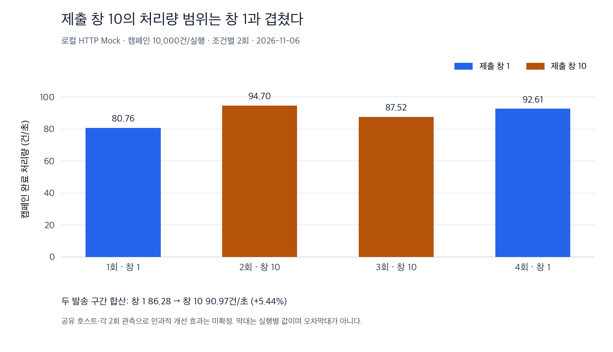

# S8 실제 HTTP 경로의 Relay 제출 창 1/10 비교

2026-11-06 KST. 시작 커밋 a61a1ee. [제출 창 오류 경계](S8_RELAY_WINDOW.md) 검증 뒤의 별도 성능 비교다.
운영 Java/resources·기본값을 바꾸지 않고 테스트 도구만 확장한다. Mock 수락은 실제 단말 도착이 아니다.

## 실행 전에 고정한 프로토콜

| 항목 | 조건 |
| --- | --- |
| 유일한 변경 요인 | CAMPAIGN Relay submission-window-size=1 또는10 |
| 순서·반복 | 1 → 10 → 10 → 1, 조건별2회 |
| 매 실행 데이터 | 새 MySQL/Kafka/Redis, 사전 저장 캠페인10000건 |
| 실시간 제출 창 | 모든 실행1 |
| Relay·DB 완료 묶음 | 역할별 Relay1, publish-batch-size=1 |
| Producer | none, linger0, batch.size16384, acks=all, idempotence=true, max.in.flight1, retries3 |
| Producer 버퍼·시간 | buffer.memory1MiB, max.block3초/request3초/delivery10초 |
| Topic | 양쪽 요청/Retry/DLQ 각각3, broker compression=producer 확인 |
| Consumer·Worker·queue | 역할별3/3/0, RECORD·동기 commit |
| 복구·공유 quota | 복구ON·이력12, 전체1000/s·burst100 / 캠페인200/s·burst20 |
| 역할별 연결 | DB4 / Redis3·250ms / HTTP3 |
| HTTP Mock | SUCCESS·1ms, in-flight8, 10000req/s |
| 실시간 probe | 기준선50건, 이후 응답 뒤200ms 기다리는 순차 요청 |
| JVM·인프라 | heap512MiB, MySQL8.4.8 CPU2·2048MiB·buffer512MiB, Kafka4.0.2 CPU1·1024MiB, Redis7.4.11 CPU1·256MiB |
| 실행 상한 | task10분/JUnit8분, drain900초·probe5000·자원 표본452·검증 페이지1000행 |

상한 중 먼저 도달하는 제한이 적용된다. 기존 사용자 DB·토픽을 사용하지 않고 실행마다 새 컨테이너를 만든다.
두 역할의 앱과 Mock이 한 JVM/공유 개발 호스트에서 실행되므로 다중 서버 결과가 아니다.
합성 대상/내용/개수는 같지만 캠페인·알림 UUID와 생성 시각은 실행별로 다르다.
키가 달라 파티션별 작업 수에도 실행별 차이가 있을 수 있다. 동일한 파티션 배치를 재사용한 실험으로 설명하지 않는다.
여기서 캠페인10000건은 캠페인 객체1개가 생성한 대상자별 알림10000건을 뜻한다. 네 실행의 캠페인 객체는4개다.

제출10은 앱이 ACK 전에 보관하는 최대 record future 수다. Kafka 연결의 요청 수나 파티션별 batch 크기와 다르다.
DB 선점은 여전히 한 건씩 수행하므로 실제 producer batching이 생겼는지도 별도로 관측한다.
linger·압축·DB 완료 묶음을 동시에 바꾸지 않는다.

```bash
caffeinate -i ./gradlew --no-daemon --console=plain relayWindowDeliveryPilot -PcampaignWindow=1
caffeinate -i ./gradlew --no-daemon --console=plain relayWindowDeliveryPilot -PcampaignWindow=10
# 1, 10, 10, 1 순서로 각각 새 실행
```

새 task만 명시적으로 실행하며 일반 build/test에 연결하지 않는다.
1만 건/제출1·10만 허용한다. Consumer/파티션/압축/Relay 수/offset/API 계측/실패 주입 비교와 혼용하지 않는다.
결과는 실행마다 `build/reports/relay-window-delivery/window-N-*/result.json`으로 구분해 덮어쓰지 않는다.
[고정 소스·조건·순서·사전 검증](experiments/s8-relay-window-delivery-2026-11-06-group-1-source.json)을 실행 전에 보존했다.

## 정합성과 계측 경계

- 앱의 실제 RelayProperties에서 제출 창·완료 DB 묶음을 읽고 요구값과 대조한다. ProducerFactory11개 설정과 Topic/Consumer 할당도 확인한다.
- 10000개 대상 매핑·알림·작업·시도·HTTP 요청/수락·DB 결과·모든 파티션 committed=end를 대조한다.
- 비어 있는 Retry/DLQ에서 commit이 없으면 기존 도구는0으로 표시해 end=0과 대조한다. 이0을 실제 commit RPC가 실행됐다는 증거로 쓰지 않는다.
- Worker 완료와 offset이 Relay의 마지막 ACK→PUBLISHED 저장보다 먼저 보일 수 있다. 최종 정합성 검사는 양쪽 Relay의 ACK 관측 수와 PUBLISHED counter까지 맞은 뒤 수행한다.
- 정상 경로 비교이므로 publish failure·unconfirmed ACK가 하나라도 있으면 실패다. 늦게 복구되어 행 수가 같아져도 이 실행을 정상 성능 비교로 통과시키지 않는다.
- 처리량은 캠페인 live 앱 기동~마지막 DB 완료 관찰이다. preload·실시간 기준선·최종 정합성/Relay 대조 대기는 제외한다.
- API p95/p99/max는 혼합 구간의 접수 응답 지연이다. 생성~DB 완료 지연과 구분한다.
- `campaignCompletionToRelayAuditSeconds`는 마지막 DB 완료 관찰 뒤의 자원 표본·실시간 완료·offset·Relay 대조까지의 시간이다. 순수 ACK 지연이나 별도의 drain 처리량 분모가 아니다.
- `producerLifetimeMetrics`의 total은 live producer 생성~최종 대조 시점의 누적 counter다. record-send-total은 재전송도 포함할 수 있다. outgoing bytes는 producer 프로토콜 트래픽이며 시스템 전체 네트워크/과금량이 아니다.
- records/request·compression-rate·batch-size 등의 평균은 Kafka의 시간 창 값이다. 전체10000건 평균이 아니며 유효하지 않은 창은 null로 보존한다.
- **relay.ack 타이머는 직접 개선율을 비교하지 않는다.** 제출1은 send~ACK, 제출10은 해당 record 제출~drain 관측으로 다른 claim/앞선 ACK 대기도 포함한다. 보고서에 v2 의미를 역할별로 기록한다.
- 나머지 DB/Worker 타이머도 연결·트랜잭션·SQL·commit·스케줄링을 포함할 수 있다. 누적 시간을 겹치지 않는 벽시계 비율처럼 합하지 않는다.
- JVM CPU는 두 앱/Mock/JIT를 포함하며100%=한 코어다. MySQL CPU는 컨테이너 전체, lag·pool·heap 최대는 약2초 표본의 관측 최대다.

순차 probe는 고정5RPS open-loop가 아니며, 느린 실행일수록 총 요청 수가 늘 수 있다.
각2회·공유 호스트의 결과로 인과적 개선율·운영 최적값을 확정하지 않는다. 느린/빠른 실행을 제외하지 않는다.
이전 압축·Kafka 단독·100만 실험과 경계가 다르므로 직접 개선율을 계산하지 않는다.
조건별 합산 처리량은 `두 실행의 캠페인20000건 / 두 발송 구간 시간 합`으로 계산한다.
개별 처리량의 산술평균은 구분해 보조 값으로 남긴다. 실행별 p95/p99를 합치거나 평균해 전체 percentile이라고 부르지 않는다.

## 사전 검증과 실패 보존

경계·진단·Producer/Relay 관측 집중 **26개가6초/종료코드0/실패·오류·스킵0**에 통과했다.
`campaignWindow=11 --dry-run`은 실행 전 거절됐다. ACK 이전 완료/오류·미확인 전송을 정상 결과로 기록하지 않는 관측 계약도 확인했다.

초기 두 컴파일 실행은 기존 계측 API를 잘못 사용해 실패했다. 현재 SimpleMeterRegistry는 close가 있지만 AutoCloseable이 아니고,
기존 counter helper에는 tag 인자가 필요했다. 명시적 finally close와 전용 meter 조회로 수정했다.
실행 테스트0개/HTTP 실험0회인 컴파일 오류이며 성능 데이터로 사용하지 않는다.
[두 컴파일 실패·당시 소스·로그 SHA](experiments/s8-relay-window-delivery-2026-11-06-compile-failure.json)를 보존했다.

## 실제 결과

합산 처리량은 제출1 **86.279건/초**, 제출10 **90.969건/초**로 **+5.44%** 관측됐다.
두 조건의 실행별 범위는 겹쳤다. 동일 제출1도80.757→92.610건/초(+14.68%)로 달라졌으므로 설정의 인과적 개선 효과는 확정하지 않는다. **기본 제출1을 유지한다.**



4회 모두 PASS다. **캠페인40000+실시간2217=HTTP42217건**을 대조했고, 매 실행10000개 대상 매핑과 모든 offset 경계를 확인했다.
관측 중복·잘못된 참조0, Retry/DLQ 기록0, 양쪽 Relay publish failure·unconfirmed ACK0이었다.
Producer 재시도/전송 오류와 Redis quota 오류6종도 두 역할·모든 실행0이었다. 복구ON의 성능 효과를 입증한 실험은 아니다.

| 순서 | 제출 창 | 발송 구간 초 | 캠페인 건/초 | 실시간 수락 | 혼합 API p95 / p99 / 최대 ms |
| --- | --- | --- | --- | --- | --- |
| 1 | 1 | 123.828 | 80.757 | 594 | 20.579 / 284.230 / 906.716 |
| 2 | 10 | 105.597 | 94.700 | 532 | 16.189 / 35.014 / 128.566 |
| 3 | 10 | 114.257 | 87.522 | 552 | 19.332 / 313.179 / 493.524 |
| 4 | 1 | 107.980 | 92.610 | 539 | 14.222 / 27.513 / 73.177 |

사전 저장은 순서대로 19.888 / 19.801 / 18.085 / 18.837초였다. 이 시간은 발송 처리량의 분모에 포함하지 않았다.

| 조건(각2회·캠페인20000건) | 발송 시간 합계 초 | 합산 건/초 | 실행별 건/초 산술평균 | 실행별 처리량 범위 | 혼합 API p95 범위 ms |
| --- | --- | --- | --- | --- | --- |
| 제출1 | 231.807 | 86.279 | 86.684 | 80.757~92.610 | 14.222~20.579 |
| 제출10 | 219.854 | 90.969 | 91.111 | 87.522~94.700 | 16.189~19.332 |

주 비교는 `20000 / 두 발송 시간 합`이다. 실행별 처리량 산술평균 차이(+5.11%)는 별도 추정량이며 합산 처리량과 섞지 않는다.
Percentile은 실행별 값과 범위만 제시했다. 표본 수가 다른 실행들의 p95/p99를 평균해 전체 percentile로 만들지 않았다.
공유 호스트의 캐시·I/O·스케줄링 등을 분리 통제하지 않았고, 느린/빠른 실행을 제외하지 않았다.

### 실시간 생성→DB 완료 지연

| 순서 | 제출 창 | 단독 기준선 DB p95 ms | 혼합 DB p95 ms | 혼합 DB p99 ms | 혼합 DB 최대 ms |
| --- | --- | --- | --- | --- | --- |
| 1 | 1 | 525.634 | 496.083 | 617.799 | 1307.813 |
| 2 | 10 | 503.178 | 478.678 | 568.246 | 756.233 |
| 3 | 10 | 543.812 | 520.654 | 629.727 | 1553.200 |
| 4 | 1 | 517.666 | 498.910 | 561.998 | 679.543 |

API 접수 p95와 생성→DB 완료 p95는 다른 지연이다. 이 네 관측으로 실시간 지연 개선이나 운영 SLO를 확정하지 않는다.
생성→DB 완료도 공급자 수락 결과의 DB 기록 경계이며 휴대폰 표시/열람 시간이 아니다.

### 실제 producer 묶음과 바이트

아래 표는 캠페인 producer의 수치다. 실시간 producer의 제출 창과 압축은 모든 실행에서1/none이다.

| 순서 | 제출 창 | records/request 시간 창 평균 | request-total 누적 | outgoing-byte-total 누적 |
| --- | --- | --- | --- | --- |
| 1 | 1 | 1.000000 | 10004 | 3800290 |
| 2 | 10 | 1.000828 | 9984 | 3797782 |
| 3 | 10 | 1.001093 | 9985 | 3797938 |
| 4 | 1 | 1.000000 | 10004 | 3800290 |

제출10에서도 평균은1.000828~1.001093으로 대부분1 record/request였다. 10개 묶음 전송이 일반적으로 발생한 결과가 아니다.
평균 outgoing counter는3800290→3797860바이트(-0.064%)였다. 전체 서비스 네트워크 절감률이 아니다.
요청 counter에는 producer 초기화/metadata 등도 포함되므로 이를 Produce 요청 수로 단정하지 않는다. 평균 metric은 전체10000건 평균이 아니다.
단건 DB 선점과 linger0 구조에서는 제출 창이 파티션별 batch 크기를 강제하지 않는다. 이번 실제 관측도 큰 묶음 증가를 보여주지 않았다.

### 자원과 단계별 시간

| 순서 | JVM CPU % | MySQL CPU % | 캠페인 lag 관측 최대 | 실시간 lag 관측 최대 | 캠페인 DB active / 대기 관측 최대 | heap 관측 최대 MiB | GC 증가 ms |
| --- | --- | --- | --- | --- | --- | --- | --- |
| 1 | 41.69 | 52.65 | 109 | 2 | 4 / 1 | 105.29 | 567 |
| 2 | 47.06 | 63.29 | 150 | 2 | 4 / 0 | 104.30 | 472 |
| 3 | 45.29 | 60.97 | 144 | 3 | 4 / 0 | 104.11 | 570 |
| 4 | 47.65 | 56.78 | 135 | 2 | 4 / 0 | 103.87 | 530 |

CPU는 누적 CPU 시간/자원 표본의 벽시계 시간으로 계산했다(100%=한 코어). 구간 길이와 실시간 요청 수가 달라 단순 효율 개선율로 해석하지 않는다.
lag gauge 나이의 관측 최대는4.932~5.013초였다. DB 대기0인 표본만으로 순간 대기나 잠금이 없었다고 보장하지 않는다.
각 값은 관측 표본의 최대이며 모든 순간의 최고치가 아니다.

| 순서 | Relay 선점 호출 평균 ms | PUBLISHED 저장 평균 ms | Worker handler 평균 ms | Worker 공급자 평균 ms |
| --- | --- | --- | --- | --- |
| 1 | 5.763 | 3.392 | 21.262 | 1.817 |
| 2 | 5.448 | 2.855 | 19.294 | 1.714 |
| 3 | 6.025 | 3.041 | 21.430 | 1.864 |
| 4 | 4.877 | 2.723 | 18.436 | 1.883 |

Relay 선점 count는10021~10024이며 idle 조회도 포함한다. 완료 저장/handler/공급자 count는 각10000이었다.
단계 타이머는 DB 연결·트랜잭션·SQL·commit·스케줄링 등이 포함된 호출 시간이고 내부 단계가 겹친다. 합계를 벽시계 비율로 더하지 않는다.
같은 제출1의 선점·완료 저장·handler 시간도 실행별로 달랐다. 특정 SQL·lock·호스트 원인이나 제거한 ACK 대기만의 효과로 확정하지 않는다.
공급자 평균1.714~1.883ms에 비해 handler는18.436~21.430ms였다. 이 평균만으로 병목을 확정하지 않지만 외부 I/O가 주병목이라는 근거도 확보하지 못했다. 가상 스레드 비교는 조건부 후보로 남긴다.

## 검산·적용 판단·다음 단계

검산 범위에서 원본·표·그림의 수치와 정합성이 일치했다. 관측 비교로 참고할 수 있으나 인과적 개선 효과는 미확정이다.
원본 SHA,167개 소스 불변, 유일한 설정 차이, HTTP/DB/매핑/9개 offset 행, ACK·PUBLISHED 수를 대조했다.
Java의 요약 값을 그대로 복사하는 데 그치지 않고 원본 distinct 캠페인 수와 발송 초로 Decimal 처리량을 다시 계산했다.

**운영 기본 제출1/완료 저장1/linger0/none을 유지한다.** 제출10 선택 옵션의 정합성과 측정 결과는 보존하되 기본값 변경의 근거로 확대하지 않는다.
다음은 병렬 완료 상황의 미완료 offset 보존 검증과 Grafana/환경별 반복 측정이다. 서버·네트워크 구성이 달라지면 같은 프로토콜로 다시 확인한다.
이번에는 10만/100만 건 확대, 새 서버/LB·유료 자원, 실제 단말 발송을 실행하지 않았다.

## 보존한 원본

- [1회 제출1 원본](experiments/s8-relay-window-delivery-2026-11-06-group-1-run-1-window-1.json)
- [2회 제출10 원본](experiments/s8-relay-window-delivery-2026-11-06-group-1-run-2-window-10.json)
- [3회 제출10 원본](experiments/s8-relay-window-delivery-2026-11-06-group-1-run-3-window-10.json)
- [4회 제출1 원본](experiments/s8-relay-window-delivery-2026-11-06-group-1-run-4-window-1.json)
- [원본 SHA·합산/산술평균·표본·계산식·검산 요약](experiments/s8-relay-window-delivery-2026-11-06-group-1-summary.json)
- [실행 전 고정 소스·프로토콜](experiments/s8-relay-window-delivery-2026-11-06-group-1-source.json)

## 전체 회귀

네 측정이 모두 끝난 뒤 `caffeinate -i ./gradlew --no-daemon --console=plain build`를 별도로 실행했다.
**16분23초/종료코드0**, 기본 test 새 실행 **48개 클래스/384개 통과, 실패·오류·스킵0**이었다.
기존379개+새 경계2개/Relay 관측3개이며 WorkerConcurrencyTest11개도 다시 통과했다.
네 opt-in 측정은 각각 별도 task의 테스트1개였고 기본384개에 포함되지 않는다. 이번에는 기존10만/100만 부하를 재실행하지 않았다.
실행 JAR task는 UP-TO-DATE였고 현재0.3.0 알림/Mock JAR SHA를 남겼다.
소스167개와 빌드 설정은 실행 전 스냅샷과 같고 운영 Java/resources diff는0이었다.
[최종 검증·JUnit/원본/소스/JAR/그림 SHA](experiments/s8-relay-window-delivery-2026-11-06-group-1-validation.json)를 보존했다.
새 푸시·원격 CI·서버/LB 배포 결과는 아니다.

공식 참고:
- [Kafka3.9 Producer 설정](https://kafka.apache.org/39/configuration/producer-configs/)
- [Kafka3.9.2 Producer API의 비동기 send·batching·응용 재발행 한계](https://kafka.apache.org/39/javadoc/org/apache/kafka/clients/producer/KafkaProducer.html)
