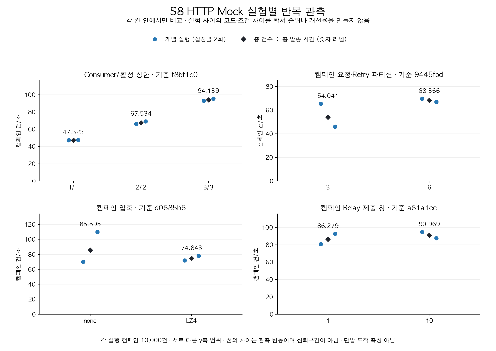

# S8 실험 종합 대조와 기본값 결정

2026-11-06 KST. 검토 시작 main=0bf380b. **실험 내 관측 비교로 참고할 수 있지만 인과적 개선율이나 운영 최적값은 확정하지 않는다.**
HTTP 실험18회와 Kafka 단독8회에서 원본·설정·해시·계산을 대조했다. 이번 작업은 기존 결과의 재검산이며 새 부하 실행은0회다.

실험에서는 Consumer/활성 상한3이1보다 높은 처리량을 보였지만, 앱 기본은 여전히 **1/1·대기 큐2**다.
실험의 외부 HTTP Mock 1ms와 기본 in-process Mock 100ms, pool/quota/실시간 설정도 다르므로
실험의47건/초 등을 현재 기본 앱의 처리 능력으로 인용하지 않는다.

## 대조 범위와 재현

[검산 스크립트](../scripts/review_s8_experiments.py)는 네 HTTP 비교 그룹의18개 원본과 Kafka 단독8개 행을 읽는다.
[검산 원본·방법·43개 근거 파일 SHA](experiments/s8-evidence-review-2026-11-06.json)에 실행별 수치와 계산값을 보존했다.

```bash
python3 scripts/review_s8_experiments.py --check docs/experiments/s8-evidence-review-2026-11-06.json
# 새 검토 파일이 필요할 때만 사용한다. 기존 파일은 덮어쓰지 않는다.
python3 scripts/review_s8_experiments.py --output /tmp/s8-new-review.json
```

그림은 [그리기 스크립트](../scripts/plot_s8_review.py)로 재생성할 수 있다.
Matplotlib3.9.2와 한글 폰트가 필요하며 이 Mac에서는 `/opt/anaconda3/bin/python3`을 사용했다.
다른 환경에서는 `--font /path/to/KoreanFont.ttf`를 지정할 수 있다. 기존 이미지 파일은 덮어쓰지 않는다.

```bash
/opt/anaconda3/bin/python3 scripts/plot_s8_review.py \
  --input docs/experiments/s8-evidence-review-2026-11-06.json --output /tmp/s8-review-rates.png
```

- 보존된 SHA와 파일의 현재 바이트, 실행 순서/설정 차이, 실제 Consumer/할당/커밋 정책을 확인한다.
- HTTP 수락·대상 매핑 수·quota 허가·중복/잘못된 참조0·파티션별 offset=end와 건수 합계를 대조한다.
- 혼합 API 표본은 실시간 전체에서 기준선50개를 뺀 집합이다. 실행별 p95와 범위만 보존하고 p95를 평균하지 않는다.
- 압축/제출 창 비교의 실제 producer 설정과 retry/error0을 확인한다. 제출 창은 ACK/PUBLISHED 수와 미확인/실패0도 대조한다.
- 기존 요약의 실행별 처리량과 조건별 산술평균을 원본에서 독립 계산한 값과 비교한다.
- 역사적 validation은 당시 소스가 실행 중 같았다고 기록한다. 이번에는 그 기록·원본의 해시를 검산했으며 당시 프로세스를 다시 실행한 것은 아니다.
- 본문/토큰/수신자를 재수집하지 않는다. 원본 JSON에 기록된 과거 DB·HTTP 검증을 지금의 실제 DB 재조회로 표현하지 않는다.

| 그룹 | 유효 순서 | 데이터·반복 | 기준 커밋 | 비교 범위 |
| --- | --- | --- | --- | --- |
| [동시성](S8_CONSUMER_SCALING.md) | 1→2→3→3→2→1 | 각1만 건, 설정별2회 | f8bf1c0 | Consumer와 활성 상한을 함께 변경, 실시간3/3 고정 |
| [파티션](S8_PARTITION_SCALING.md) | 3→6→6→3 | 각1만 건, 설정별2회 | 9445fbd | 캠페인 요청·Retry 파티션만 변경, Consumer/활성3/3·복구용량12 고정 |
| [압축](S8_COMPRESSION_DELIVERY.md) | none→LZ4→LZ4→none | 각1만 건, 설정별2회 | d0685b6 | 순차ACK/linger0·none 실시간 producer 고정 |
| [제출 창](S8_RELAY_WINDOW_DELIVERY.md) | 1→10→10→1 | 각1만 건, 설정별2회 | a61a1ee | 완료 저장1/linger0/none 고정, 캠페인 future 상한만 변경 |
| [Kafka 단독](S8_PRODUCER_BATCHING.md) | A→B→C→D→D→C→B→A | 각 준비150+본 측정1500, 설정별2회 | 790a02b | 같은 브로커의 새 토픽, 고정 합성 내용·key·timestamp |

HTTP 합계는 캠페인180000+실시간12065=**192065회 수락**이다. 실시간에는18회 기준선900개가 포함된다.
각 실험에서 검증한 건수를 합한 값이며 전체 고유 고객 수나 단말 도착 수가 아니다.
Kafka 단독의 준비1200+본 측정12000=13200개 레코드는 HTTP 합계에 더하지 않는다.

## 조건을 어디까지 같다고 볼 수 있나

HTTP 그룹들은 Java21.0.6/macOS15.7.7 aarch64·같은 개발 호스트, heap512MiB,
MySQL8.4.8 CPU2/2048MiB/buffer512MiB, Kafka4.0.2 CPU1/1024MiB, Redis7.4.11/256MiB의 관측이다.
역할별 DB4/Redis3·250ms/HTTP3, Mock SUCCESS·1ms, quota 전체1000/s·캠페인200/s,
기준선50개/응답 뒤200ms 순차 probe, Relay1/완료 저장1/동기 RECORD의 프로토콜을 사용했다.
앱·Mock은 같은 JVM에 있고 실제 호스트 CPU/I/O/캐시까지 격리한 실험은 아니다.

한 그룹 안에서 변경 요인 외에 원본이 기록한 환경/settings/bounds/처리 정책이 같은지 대조했다.
다만 모든 설정이 모든 버전에서 원본 runtime 필드로 계측된 것은 아니다. DB pool/queue/timeout 등의
추가 조건은 당시 프로토콜·소스 스냅샷을 함께 근거로 삼는다. 새 검산이 그 값을 실시간으로 다시 읽었다고 주장하지 않는다.

각 HTTP 실행은 새 인프라·동일 합성 대상 규격/개수지만 UUID·생성 시각·파티션 분포가 다르다.
실행 순서와 코드·복구 용량·계측 버전도 그룹 사이에 차이가 있다. 특히 Relay ACK 타이머는 제출 창 경로에서 의미가 달라졌다.
따라서 네 그룹을 시간순 속도 향상 그래프로 묶거나, 빠른 조건만 조합한 성능을 예측하지 않는다.
Kafka 단독은 데이터·분모·검증 경계도 달라 앱 처리량과 직접 비교하지 않는다.

## HTTP 처리량 재계산

주 지표는 **같은 그룹·같은 조건에서 총 캠페인 수락20000건÷두 발송 구간 시간 합**이다.
발송 구간은 캠페인 live 앱 기동부터 마지막 DB 완료 관찰까지이며 앱 기동·관측 비용도 포함한다.
사전 저장·실시간 기준선·최종 전수 검증은 그 분모에서 제외한다.
보조 지표인 실행별 처리량 산술평균도 함께 적어 과거 요약과 연결한다. 두 값이 다른 것은 계산 오류가 아니다.
표는 반올림 전 원본으로 계산하고 소수3자리에서 일반적인 사사오입(half-up)으로 표시한다.

| 실험 | 조건 | 합산 처리량 건/초 | 실행별 산술평균 건/초 | 개별 실행 범위 건/초 | 혼합 API p95 범위 ms |
| --- | --- | ---: | ---: | --- | --- |
| 동시성 | 1/1 | 47.323 | 47.324 | 47.159~47.488 | 13.069~13.773 |
| 동시성 | 2/2 | 67.534 | 67.566 | 66.107~69.025 | 13.058~14.637 |
| 동시성 | 3/3 | 94.139 | 94.154 | 92.957~95.351 | 15.451~17.116 |
| 파티션 | 3 | 54.041 | 55.749 | 45.989~65.509 | 37.564~84.348 |
| 파티션 | 6 | 68.366 | 68.392 | 67.071~69.712 | 28.868~31.747 |
| 압축 | none | 85.595 | 90.019 | 70.064~109.973 | 11.144~28.477 |
| 압축 | LZ4 | 74.843 | 74.970 | 71.878~78.062 | 31.133~55.880 |
| 제출 창 | 1 | 86.279 | 86.684 | 80.757~92.610 | 14.222~20.579 |
| 제출 창 | 10 | 90.969 | 91.111 | 87.522~94.700 | 16.189~19.332 |



파티션3→6은 산술평균 기준 **55.749→68.392(+22.68%)**, 합산 기준 **54.041→68.366(+26.51%)**다.
같은 데이터에서 다른 추정량을 선택한 결과이며 +22.68%를 계산 오류로 고치지 않는다.
압축 none→LZ4도 산술평균 **90.019→74.970(-16.72%)**, 합산 **85.595→74.843(-12.56%)**다.
원본에 있는 느린/빠른 실행을 빼지 않았다. 개별 p95를 합치거나 평균한 값은 제시하지 않는다.

동시성3/3은 해당 실험에서 처리량이 높았지만 CPU·DB 활성 연결도 늘었고 실시간 p95가 더 높게 관측됐다.
파티션과 압축은 동일 조건의 두 실행 차이도 컸다. 제출 창10은 합산 **86.279→90.969(+5.44%)**지만 범위가 겹쳤고
기준 창1의 첫/마지막 차이도14.68%였다. **설정의 인과적 효과·유의성·운영 최적값은 미확정**이다.

## Kafka 단독 결과를 앱 결과로 확대하지 않는다

| 조건 | 제출/linger/압축 | 합산 record/초 | 실행별 산술평균 record/초 | 본 측정 outgoing byte 평균 |
| --- | --- | ---: | ---: | ---: |
| A | 1 / 0ms / none | 1229.690 | 1249.438 | 738500 |
| B | 1 / 5ms / none | 122.742 | 122.879 | 738500 |
| C | 10 / 5ms / none | 1263.151 | 1263.513 | 548300 |
| D | 10 / 5ms / LZ4 | 1208.538 | 1208.564 | 176020 |

본 측정은 첫 제출~마지막 ACK까지다. 모든8회에서 본 측정 전송1500/retry0/error0, 내용·순서·offset을 대조했다.
준비 구간 retry는0/1/0/0/3/3/1/0으로 따로 보존했다. 전체 send counter를 고유 레코드 수로 간주하지 않는다.
C→D의 outgoing counter 평균은67.90% 감소했지만 앱 순차ACK 압축 실험의 lifetime counter 감소는4.79%였다.
앞은 준비를 뺀 측정 차분, 뒤는 producer 생존 구간 누적값이며 실제 네트워크 과금이나 같은 처리 경계가 아니다.

앱 제출 창10에서 records/request의 시간 창 평균도1.000828~1.001093이었다.
future10개가 파티션별10건 batch나 네트워크 요청10개를 뜻하지 않는다.
순차 ACK에 linger만 더하거나 broker 단독 수치를 앱 성능 향상으로 인용하지 않는다.

## 저장소 기본값과 실험 옵션

아래는 환경변수/실행 인자로 덮어쓰기 전 저장소 기본값이다. 실행 중인 사용자의 실제 설정을 대신하지 않는다.

| 항목 | 저장소 기본 | S8 성능 실험에서 사용한 값 | 판단 |
| --- | --- | --- | --- |
| Consumer/활성/대기 | 1/1/2, 대기1000ms | 캠페인N/N/0 또는3/3/0, 실시간3/3/0 | 실험 도구의3과 구분, 기본 유지 |
| 요청·Retry·DLQ 파티션 | 각3 | 캠페인 요청·Retry만3/6 비교 | 기존 key/순서·복구 예산 영향이 있어 기본3 유지 |
| Relay 제출/완료 저장 | 1/1 | 제출1/10·완료 저장1 | 선택 옵션은 보존, 기본1 유지 |
| Producer 압축/linger | none/0ms(현행3.9.2 클라이언트 기준) | none/LZ4, 앱 linger0 | 앱 이득 근거 부족, 유지 |
| offset | RECORD·동기 commit | 동일 | COUNT_TIME은 별도 비교 옵션, 앱 기본 유지 |
| 공급자 | in-process MOCK·100ms | 외부 HTTP Mock·1ms | 측정 처리량을 기본 앱 용량으로 인용하지 않음 |
| DB/Redis/HTTP 연결 | 8/2/2 | 4/3/3 | 실험 프로토콜과 분리 |
| Redis 제한기·역할 분리 | 기본 OFF/OFF, 활성 시 전체10/s·캠페인2/s | ON/ON·전체1000/s·캠페인200/s | 현재 앱에 실험 예산을 자동 적용하지 않음 |
| 일시 오류 복구/이력 용량 | 기본 OFF/6 | ON, 파티션 이후 비교12 | 정상 실험의 조회 오류0으로 복구 효과를 입증하지 않음 |

근거는 [application.yml](../src/main/resources/application.yml), [Relay 기본값](../src/main/java/dev/jinhyeon/notificationlab/config/RelayProperties.java),
[토픽 선언](../src/main/java/dev/jinhyeon/notificationlab/config/AsyncConfiguration.java)과 각 실험 원본이다.
[Consumer 문서](S8_CONSUMER_SCALING.md)의 “운영 기본값은 이미3”을 정정했다. 당시 기준 커밋의 설정 SHA도 스냅샷과 맞춰1/1/2를 확인했다.
운영 설정과 역사적 측정 원본은 바꾸지 않았다.

## 실패·정확성 경계와 다음 단계

Consumer 그룹1은 설정 검증 실패로 유효 표본0개였고 보완 후 그룹2의6회를 사용했다.
Kafka 단독의 초기 두 계측 실패도 원본/소스가 보존돼 있으며 보완한8회와 구분한다.
이들은 느린 정상 실행을 제외한 것이 아니라 시작/계측 계약이 다른 실패 실행이다. [검산 JSON](experiments/s8-evidence-review-2026-11-06.json)의 근거 해시에 함께 연결했다.

[파티션 변경 계약](S8_PARTITION_EXPANSION.md)·[복구 용량](S8_PARTITION_RECOVERY.md)·[제출 창 오류 경계](S8_RELAY_WINDOW.md),
[offset 보존](S8_OFFSET_ORDER.md)·[모니터링](S8_MONITORING.md)은 각각의 검증 범위다.
정상 HTTP 비교의 관측 중복0이 외부 exactly-once를 보장하지 않는다.
완료 저장 실패 복구에서는 논리 작업4개에 HTTP 수락5회가 발생했다. offset 보존과 외부 중복 방지는 다른 문제다.

필수 S8 반복 실험·원본 대조는 여기까지 정리했다. 가상 스레드는 **외부 I/O가 주병목일 때만** 검토하는 조건부 항목으로 남긴다.
기존 공급자 평균1.714~1.883ms/handler18.436~21.430ms 관측만으로 주병목을 확정하지 않는다. 비교를 실행했다고 표시하지 않는다.
[최초100만 건 API timeout의 원인](S7_DELIVERY_MILLION_SUCCESS.md)도 미확정이며 후속 성공을 원인 해결의 증거로 쓰지 않는다.

다음은 S9의 문제→선택→결과 정리와 로컬 프록시/LB+API2·Worker2 검증이다.
실제 서로 다른 호스트의 네트워크/장애 내성이나 유료 클라우드 배포는 아직 검증하지 않았다.

## 이번 작업의 검증

오프라인 검산의 매핑/설정/offset/중복/분모/과거 평균/미확인 ACK/producer retry/SHA 오류,
기존 파일 덮어쓰기와 변형 보고서 수용을 막는 제어11개를 확인했다. 변형은 메모리/임시 디렉터리에만 적용했다.
그림의18개 점과9개 합산 값·0 시작 축·라벨을 실제 이미지에서 확인하고 같은 최종 스크립트로 재생성해 PNG SHA도 대조했다.

`caffeinate -i ./gradlew --no-daemon --console=plain test`는 **6초/종료0·test UP-TO-DATE**였다.
새 JUnit 실행은0개다. 직전 [모니터링 전체 회귀](experiments/s8-monitoring-2026-11-06-validation.json)의49개 클래스/389개 결과를
소스168개·설정10개·JUnit 파일 SHA와 대조해 재사용한 것이며 새로389개를 실행했다고 표현하지 않는다.
[이번 검증·제어 사례·파일 SHA](experiments/s8-evidence-review-2026-11-06-validation.json)를 보존했다. 새 푸시/원격 CI는 미실행이다.
